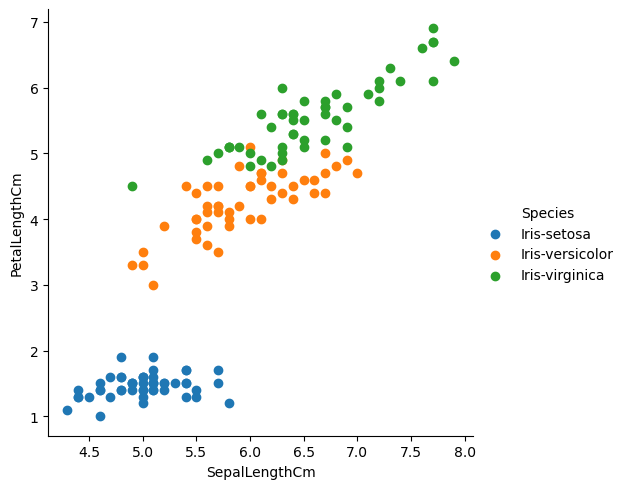
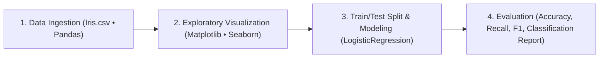

# Iris Flower Classification (`Iris-Flower-Classification`)

## Table of Contents
- [Executive Summary & Business Utility](#executive-summary--business-utility)
- [Visual Showcase (UI & Dashboards)](#visual-showcase-ui--dashboards)
- [System Architecture & Layers](#system-architecture--layers)
- [Data Model & Dataset Schema](#data-model--dataset-schema)
- [Model Pipeline & Evaluation](#model-pipeline--evaluation)
- [Getting Started](#getting-started)
- [Business Value, ROI & Growth Opportunities](#business-value-roi--growth-opportunities)

---

## Executive Summary & Business Utility
`Iris-Flower-Classification` implements a clean, reproducible supervised machine learning classification workflow in Python (`iris.ipynb`, 15 cells) on `Iris.csv` (150 samples) using **Logistic Regression** to classify *Iris-setosa*, *Iris-versicolor*, and *Iris-virginica* from morphological measurements.

---

## Visual Showcase (UI & Dashboards)
Exploratory & evaluation visualization extracted from `iris.ipynb`:



---

## System Architecture & Layers


| Layer | Tools & Libraries |
| :--- | :--- |
| **Data Processing** | `pandas`, `numpy` |
| **Visualization** | `matplotlib.pyplot`, `seaborn` |
| **ML Modeling** | `sklearn.model_selection.train_test_split`, `sklearn.linear_model.LogisticRegression` |
| **Metrics** | `accuracy_score`, `f1_score`, `recall_score`, `classification_report` |

---

## Data Model & Dataset Schema
- **Source**: `Iris.csv` (**150 rows**)
- **Columns**: `Id`, `SepalLengthCm`, `SepalWidthCm`, `PetalLengthCm`, `PetalWidthCm`, `Species`

---

## Model Pipeline & Evaluation
1. Load & inspect `Iris.csv` distributions with Seaborn/Matplotlib.
2. Split into training and test sets (`train_test_split`).
3. Fit `LogisticRegression` and evaluate multi-class precision, recall, F1, and accuracy.

---

## Getting Started
```bash
git clone https://github.com/islamsamyy/Iris-Flower-Classification.git
cd Iris-Flower-Classification
jupyter notebook iris.ipynb
```

---

## Business Value, ROI & Growth Opportunities
- **Modular Tabular Classification Baseline**: Serves as a clean template for rapid multi-class classification PoCs (e.g., product SKU categorization, customer segment classification) and can be wrapped in a FastAPI inference service.
